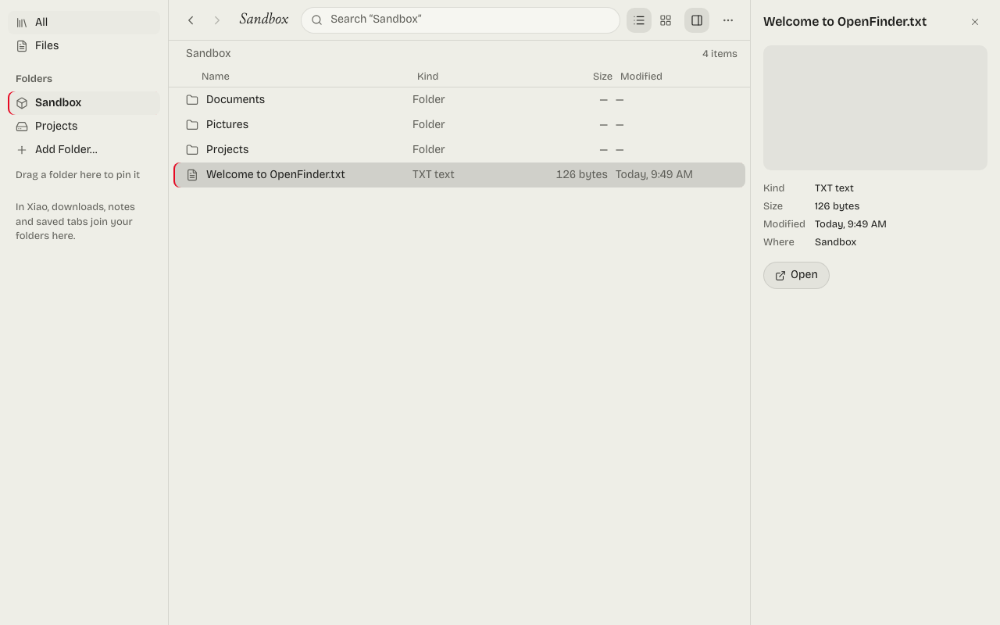

<div align="center">


# OpenFinder

**A local-first file library that runs in your browser. Inside the Xiao browser it is the Library.**

[Quick start](#quick-start) · [In Xiao](#in-xiao) · [Status](#status) · [Limits](#known-limits) · [Development](#development) · [Credits](#credits)


<picture>
  <source media="(prefers-color-scheme: dark)" srcset="docs/screenshot-dark.png">
  
</picture>

</div>

OpenFinder is an independent project and is not affiliated with or endorsed by Apple.

## Quick start

```sh
npm install
npm run build
npm start        # then open http://localhost:4627 in Chrome, Edge, Brave, Opera or Arc
```

On a Mac you can double-click `start.command` instead; it does the three steps and opens the browser.

Click **Allow File Access…**, pick a folder, and start working. There is no account and no server, and your files never leave your computer.

## In Xiao

[Xiao](https://github.com/Gitguy268/xiao) ships OpenFinder as its Library, an optional download (start page → Features → Library). There it can do more than a web page can, because Xiao does the file work itself and checks every request:

- **Downloads:** each finished download, found by the name it came with.
- **Files:** the folders you choose, searched by name, earlier name, tag and collection.
- **Notes:** the sticky notes.
- **Archive:** tabs Xiao's auto-archive closed, each reopened in its own space and container.
- **Scans** of large folders show in the sidebar and can be stopped; what was found so far stays.
- **Collections and saved searches:** references, never copies.
- **Tidy names:** reviewed before anything changes, and every rename can be undone.
- **Move to Trash:** the system's Trash, never a permanent delete.

`npm run build:xiao` makes that build. Xiao's `npm run packs` takes it from `dist-xiao/`.

## Status

| Part | State |
|---|---|
| Xiao's design: paper and ink, Bricolage and Junicode, light and dark | Done |
| List and grid views, preview pane, keyboard use (⇧⌘F / Ctrl+Shift+F searches everything) | Done |
| Search with filters (`type:pdf`, `tag:`, `source:`, `before:`, `after:`, quoted words) | Done |
| Folders, the Sandbox, pinned folders | Done |
| In Xiao: downloads, notes, tags, collections, saved searches, tidy names with undo, Move to Trash | Done |
| Archives, converting files, sharing | Planned |

<details><summary>The search language</summary>

| You type | It finds |
|---|---|
| `invoice` | names with that word, best match first: exact name, then names starting with it, then words, then letters in order |
| `"tax return"` | those words together |
| `type:pdf`, `type:image` | an extension, or a kind: image, video, audio, document, text, code, archive, folder |
| `tag:research` | files with that tag (in Xiao) |
| `source:downloads` | downloads, files or notes (in Xiao) |
| `before:2026-10-01`, `after:2026-09` | last changed before or after a day or month |

A filter with a value it can't read is searched as plain words, and the page says so.

</details>

## Known limits

- **Standalone, Chromium browsers only can open folders.** Firefox and Safari have no folder access for web pages; there OpenFinder offers the Sandbox. In Xiao, which is built on Firefox, Xiao itself opens the folders.
- **Brave** ships with local folder access switched off. Enable `brave://flags/#file-system-access-api` and relaunch.
- **Browsers refuse the Home, Desktop, Documents and Downloads folders themselves.** Pick a folder inside one of them.
- **Permission is asked again after a browser restart.** One click on the folder brings it back.
- **The Sandbox** is private storage inside the browser, not a folder on your disk. Clearing the site's data deletes it.
- **Standalone has no undo and no Trash.** It renames in place where Chromium allows it. Undo and the Trash need Xiao.

## Development

```sh
npm run dev           # dev server on http://localhost:4627
npm test              # unit tests
npm run e2e           # builds, then runs the browser tests in Chromium
npm run build:xiao    # the build Xiao packs as its Library
npm run tokens        # copies Xiao's design tokens and heading font (XIAO=/path/to/xiao, default ../xiao)
npm run contract      # copies the Library protocol, search and naming rules from Xiao
npm run licenses      # fails when a dependency is missing from THIRD_PARTY_NOTICES.md
```

Xiao owns the protocol and the design tokens; OpenFinder only copies them, and the copies record where they came from. The reasons behind choices are in [docs/DECISIONS.md](docs/DECISIONS.md), the license audit in [docs/LICENSE-AUDIT.md](docs/LICENSE-AUDIT.md).

## Credits

Copyright © 2026 Lucas Van De Weerd. OpenFinder is free software under the [GNU General Public License, version 3 or later](LICENSE).

- The design, the Library protocol and the naming rules come from [Xiao](https://github.com/Gitguy268/xiao) (MPL-2.0, same author).
- Fonts: [Bricolage Grotesque](https://github.com/ateliertriay/bricolage) and [Junicode](https://github.com/psb1558/Junicode-font) (OFL-1.1). Icons: [Lucide](https://lucide.dev) (ISC).
- Feature ideas come from [FileBrowser Quantum](https://github.com/gtsteffaniak/filebrowser) (Apache-2.0). No code was used.

Every reused project and its full license text is listed in [THIRD_PARTY_NOTICES.md](THIRD_PARTY_NOTICES.md) and in the app under Actions > About OpenFinder.
